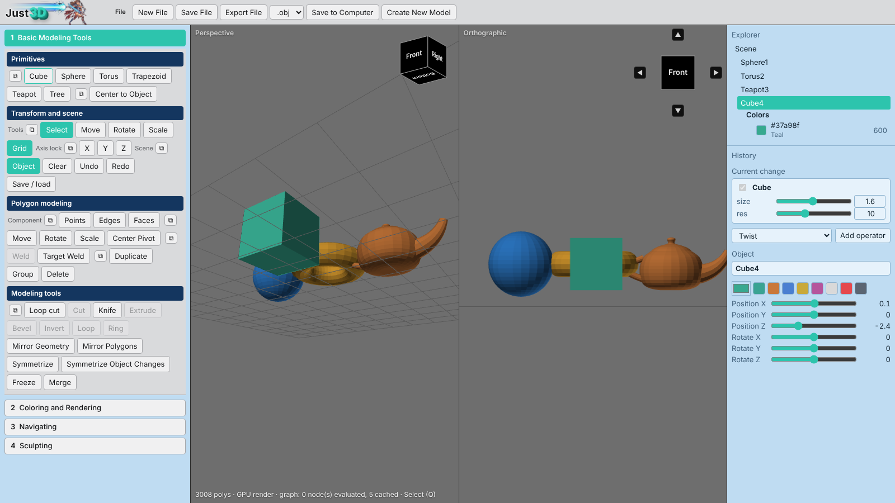

<p align="center"></p>

<h1 align="center">Just3D</h1>
<p align="center"><b>A fast, lightweight 3D modeler that runs in one file.</b><br>
Polygon modeling, a non-destructive history stack, symmetry tools and sculpting — no install, no account.</p>

<p align="center">
  <a href="https://github.com/Shredder565/Just3D/releases/latest"></a>
  <a href="https://shredder565.github.io/Just3D/src/Just3D.html"></a>
</p>
<p align="center">
  
  
  
</p>

<p align="center"></p>

## Features

- **Two viewports** — a perspective view and an orthographic view side by side, each with its own camera and view cube. `Space` toggles perspective-only.
- **Non-destructive history** — every operation is a step in a History stack. The current change is shown as an open card; earlier steps sit beneath it and can be reopened and edited.
- **Polygon modeling** — points, edges and faces, move/rotate/scale, loop cut, knife, World Draw, Object Draw and Free Draw (draw an outline, right-click to close it into a face, or to cut it into an existing object), extrude (always outward), bevel, weld and target weld, duplicate, group.
- **Symmetry** — Mirror Polygons (live symmetry editing, Alt+X), Symmetrize and *Symmetrize Object Changes*, which clones the edited half of an object to the other side without losing history. Paint and deleted faces carry over.
- **Merge** — join two or more overlapping objects: interior faces are removed and the seam is welded.
- **Face colours and rendering**, camera tools, and **sculpting** brushes.
- **Primitives** — cube, sphere, torus, trapezoid, teapot, tree.
- **Export** to OBJ; save and load your work.
- **Keyboard shortcuts** — press `Shift+?` for the full list.

## Download

### Windows
1. Grab **`Just3D-vNN-windows.zip`** from the [latest release](https://github.com/Shredder565/Just3D/releases/latest).
2. Right-click the zip → **Properties** → tick **Unblock** → OK, then extract it.
3. Double-click `Just3D-vNN.exe`.

The exe is a tiny launcher (about 2 MB) that opens Just3D in its own window using Microsoft Edge (included with Windows 11) or Google Chrome. Nothing is installed; settings live in `%LOCALAPPDATA%\Just3D`.

> **SmartScreen note:** the exe is not code-signed, so Windows may show "Windows protected your PC" the first time. Choose **More info → Run anyway**, or use the Unblock step above. You can also read the code in this repo and [build it yourself](#build-from-source) for your own use.

### Any platform
Open the [web version](https://shredder565.github.io/Just3D/src/Just3D.html) in a modern browser, or download `src/Just3D.html` and open it locally — it is one self-contained file.

## Build from source

The whole app is a single HTML file: [`src/Just3D.html`](src/Just3D.html). The Windows launcher is a small Go program in [`launcher/`](launcher) that embeds it.

```bash
# requires Go 1.24+ and zip
./build.sh v91        # -> dist/Just3D-v91-windows.zip
```

The exe icon is generated by `python3 tools/mksyso.py` (needs Pillow) from `assets/icon256.png`.

## Project layout

| Path | What it is |
|---|---|
| `src/Just3D.html` | The entire application (HTML, CSS, JavaScript) |
| `launcher/` | Go launcher that embeds the app and opens it in an app-mode browser window |
| `tools/mksyso.py` | Generates the Windows icon resource |
| `assets/` | Logo, icon and screenshot |
| `index.html` | Project landing page (GitHub Pages) |
| `CHANGELOG.md` | What changed in every version |

## Changelog
See [CHANGELOG.md](CHANGELOG.md).

## Download counter
The badge above and the counter on the [project page](https://shredder565.github.io/Just3D/) show the total number of release-asset downloads reported by GitHub. It counts downloads, not unique people.

## License
Copyright © 2026 Packing Protons. **All rights reserved.** You may download and run Just3D for personal, non-commercial use and read the source here, but you may not copy, modify, redistribute or sell it without written permission. See [LICENSE](LICENSE).
